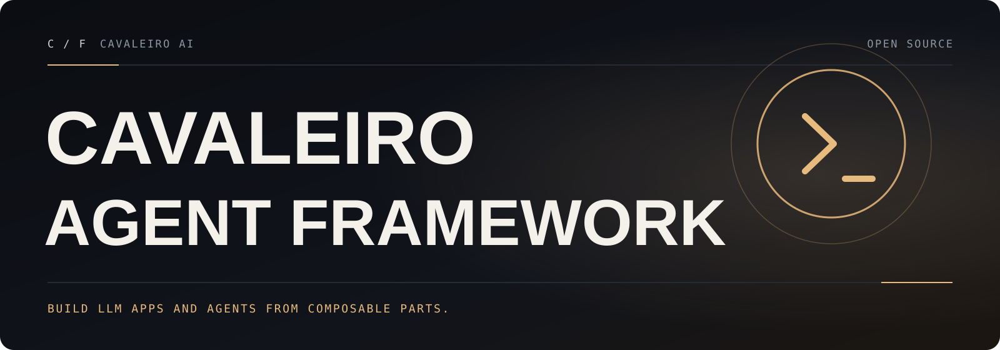

**English** · [Português (Brasil)](README.pt-BR.md)

<a id="top"></a>

<p align="center">
  
</p>

# Cavaleiro Agent Framework

**Build LLM apps and agents from composable parts.**

Cavaleiro Agent Framework is a framework for building agents and LLM-powered applications. It keeps the package and import names of the original project and adds verified bug fixes. Through one standard interface for models, messages, prompts, tools, and retrievers, you chain interoperable components and third-party integrations, and you can swap models as the underlying technology changes.

<p align="center">
  <a href=".github/workflows/check_diffs.yml"></a>
  &nbsp;
  <a href="LICENSE"><strong>MIT</strong></a>
  &nbsp; · &nbsp;
  <a href="CHANGELOG.md">Changelog</a>
  &nbsp; · &nbsp;
  <a href="docs/cavaleiro/ENGINEERING.md">Engineering report</a>
  &nbsp; · &nbsp;
  <a href="docs/cavaleiro/GUIA-PT-BR.md">Guia em português</a>
</p>

## What Cavaleiro Agent Framework adds

Everything in the original project at commit `bd5b134`, plus:

- **Correct batch retries:** `with_retry().batch()` no longer gives a failing input another input's result, and one non-retryable error no longer discards the rest of the batch ([changelog](CHANGELOG.md#fixed)).
- **Per-input routing errors:** with `return_exceptions=True`, `RouterRunnable.batch` reports an unknown route only for that input instead of failing the whole batch ([changelog](CHANGELOG.md#fixed)).
- **Trustworthy message utilities:** `merge_message_runs` keeps invalid tool calls invalid and no longer crashes on differing `ChatMessage` roles or `FunctionMessage` names. `convert_to_openai_messages` accepts typeless content blocks. `count_tokens_approximately` counts tool calls in list content and accepts plain functions as tools ([changelog](CHANGELOG.md#fixed)).
- **Safer prompt templates:** mustache dotted names inside sections no longer pull unrelated top-level data into the prompt ([changelog](CHANGELOG.md#security)).
- **Parsers and splitters that do what they say:** `XMLOutputParser` keeps elements that have an `encoding` attribute, and `MarkdownTextSplitter` and `LatexTextSplitter` split on headings and sections ([changelog](CHANGELOG.md#fixed)).
- **Proof for every fix:** 30 regression tests, each shown to fail on the original code and pass here, plus an [engineering report](docs/cavaleiro/ENGINEERING.md) with the baseline, findings, and limits.
- **Windows-friendly development:** documented test commands that work on Windows ([CONTRIBUTING.md](CONTRIBUTING.md#windows)).
- **A fork that cannot publish by accident:** release, secret-using, and bot workflows are [disabled](.github/workflows-disabled/README.md). The repository also has a [contributing guide](CONTRIBUTING.md), a [security policy](SECURITY.md), and a [code of conduct](CODE_OF_CONDUCT.md).

## Quickstart

The packages in this repository keep their original names and versions, and this fork does not publish them to PyPI. Installing `langchain` or `langchain-core` from PyPI gives you the original project without these fixes. Install from this repository instead.

**Try it from a clone** (requires [uv](https://docs.astral.sh/uv/) and Git):

```bash
git clone https://github.com/cavaleiro-ai/cavaleiro-agent-framework.git
cd cavaleiro-agent-framework/libs/core
uv sync --group test
uv run python -c "import langchain_core; print(langchain_core.__version__)"
```

**Use it in your own project** with a Git dependency (pin a commit or tag for reproducible builds):

```bash
uv add "langchain-core @ git+https://github.com/cavaleiro-ai/cavaleiro-agent-framework@main#subdirectory=libs/core"
uv add "langchain-text-splitters @ git+https://github.com/cavaleiro-ai/cavaleiro-agent-framework@main#subdirectory=libs/text-splitters"
# or with pip:
pip install "langchain-core @ git+https://github.com/cavaleiro-ai/cavaleiro-agent-framework@main#subdirectory=libs/core"
```

A first chain, without any API key, using the built-in fake chat model:

```python
from langchain_core.language_models import GenericFakeChatModel
from langchain_core.output_parsers import StrOutputParser
from langchain_core.prompts import ChatPromptTemplate

prompt = ChatPromptTemplate.from_messages(
    [("system", "Answer in one short sentence."), ("human", "{question}")]
)
model = GenericFakeChatModel(messages=iter(["Runnables compose with |."]))
chain = prompt | model | StrOutputParser()

print(chain.invoke({"question": "What is a runnable?"}))  # Runnables compose with |.
```

With a real model provider, install the `langchain` package (`libs/langchain_v1`) and a provider integration (for example `libs/partners/openai`), set the provider's API key (for example `OPENAI_API_KEY`), and use the same interface:

```python
from langchain.chat_models import init_chat_model

model = init_chat_model("openai:gpt-5.5")
result = model.invoke("Hello, world!")
```

## Repository layout

This is a Python monorepo. Each package under `libs/` has its own `pyproject.toml`, `uv.lock`, and tests.

| Path | Distribution (unchanged) | Role |
|---|---|---|
| `libs/core` | `langchain-core` | Base abstractions: runnables, messages, prompts, output parsers, tools, callbacks and tracers, documents, vector stores |
| `libs/langchain_v1` | `langchain` | Agents (`create_agent`), middleware, `init_chat_model` |
| `libs/langchain` | `langchain-classic` | Legacy chains, kept for backward compatibility |
| `libs/text-splitters` | `langchain-text-splitters` | Document chunking (character, recursive, Markdown, HTML, code, JSON, …) |
| `libs/standard-tests` | `langchain-tests` | Shared test suites for integrations |
| `libs/model-profiles` | `langchain-model-profiles` | Model capability profiles and the `langchain-profiles` CLI |
| `libs/partners/*` | `langchain-openai`, `langchain-anthropic`, `langchain-ollama`, … | Provider integrations |

The [engineering report](docs/cavaleiro/ENGINEERING.md#architecture-map) has a full architecture map.

## Development

```bash
cd libs/core                      # or the package you are changing
uv sync --all-groups              # project-local .venv
uv run --group test pytest -n 4 --disable-socket --allow-unix-socket tests/unit_tests/   # Linux/macOS
uv run --group lint ruff check .
uv run --group typing mypy .
```

On Windows, replace `--disable-socket --allow-unix-socket` with `--allow-hosts=127.0.0.1,::1`. External network access stays blocked, and asyncio can still create its local socket pair. [CONTRIBUTING.md](CONTRIBUTING.md) covers the full workflow.

## Compatibility

Cavaleiro Agent Framework changes the project's name, not its identifiers, so existing code, configuration, and serialized data keep working:

- **Python distributions and imports are unchanged:** `langchain-core` is still imported as `langchain_core`, `langchain` as `langchain`, `langchain-text-splitters` as `langchain_text_splitters`, and every partner package (`langchain-openai`, `langchain-anthropic`, …) keeps its name. Package version numbers match the original releases they are based on.
- **Public APIs are unchanged** except for the bug fixes listed in the [changelog](CHANGELOG.md), which change behavior only where it was wrong.
- **Serialization:** `dumps`/`loads` identifiers (the `["langchain", ...]` namespaces) are unchanged, so serialized objects are compatible in both directions.
- **CLI and configuration:** the `langchain-profiles` command, environment variables (`LANGSMITH_*`, `LANGCHAIN_*`, provider API keys), and config files keep their names.
- **Telemetry:** none is enabled by default. Tracing to LangSmith, an external service, only starts if you opt in (for example with `LANGSMITH_TRACING=true` and `LANGSMITH_API_KEY`). The endpoint is LangSmith's own and was not changed.
- **Documentation:** because the APIs are unchanged, the original project's documentation and API reference still describe these packages.

## Resources

- [Engineering report](docs/cavaleiro/ENGINEERING.md): architecture, baseline, findings, and verification
- [Guia completo em português](docs/cavaleiro/GUIA-PT-BR.md)
- [Contributing guide](CONTRIBUTING.md) · [Security policy](SECURITY.md) · [Code of Conduct](CODE_OF_CONDUCT.md) · [Changelog](CHANGELOG.md)
- [Report an issue](https://github.com/cavaleiro-ai/cavaleiro-agent-framework/issues/new/choose) · [Pull requests](https://github.com/cavaleiro-ai/cavaleiro-agent-framework/pulls)

<a id="license"></a>

## License

Based on LangChain · MIT License · see [LICENSE](LICENSE). Not affiliated with the original project.

<p align="center">
  <a href="#top">Back to top ↑</a>
</p>
