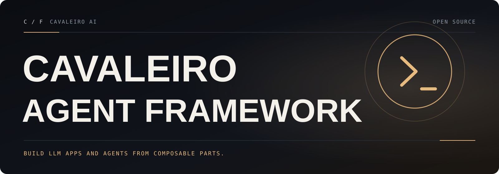

[English](README.md) · **Português (Brasil)**

<a id="top"></a>

<p align="center">
  
</p>

# Cavaleiro Agent Framework

**Crie aplicações com LLMs e agentes a partir de peças combináveis.**

O Cavaleiro Agent Framework é um framework para criar agentes e aplicações com modelos de linguagem (LLMs). Mantém os nomes de pacotes e imports do projeto original e acrescenta correções de bugs verificadas. Com uma interface padrão para modelos, mensagens, prompts, ferramentas e retrievers, você encadeia componentes interoperáveis e integrações de terceiros, e pode trocar de modelo conforme a tecnologia evolui.

<p align="center">
  <a href=".github/workflows/check_diffs.yml"></a>
  &nbsp;
  <a href="LICENSE"><strong>MIT</strong></a>
  &nbsp; · &nbsp;
  <a href="CHANGELOG.md">Changelog</a>
  &nbsp; · &nbsp;
  <a href="docs/cavaleiro/ENGINEERING.md">Relatório de engenharia</a>
  &nbsp; · &nbsp;
  <a href="docs/cavaleiro/GUIA-PT-BR.md">Guia em português</a>
</p>

## O que o Cavaleiro Agent Framework acrescenta

Tudo o que o projeto original tem no commit `bd5b134`, mais:

- **Retentativas em lote corretas:** `with_retry().batch()` não entrega mais a uma entrada que falhou o resultado de outra entrada, e um erro que não deve ser repetido não descarta mais o restante do lote ([changelog](CHANGELOG.md#fixed)).
- **Erros de roteamento por entrada:** com `return_exceptions=True`, `RouterRunnable.batch` informa uma rota desconhecida só na entrada afetada, em vez de derrubar o lote inteiro ([changelog](CHANGELOG.md#fixed)).
- **Utilitários de mensagens confiáveis:** `merge_message_runs` mantém chamadas de ferramenta inválidas como inválidas e não quebra mais com papéis (`role`) diferentes em `ChatMessage` ou nomes diferentes em `FunctionMessage`. `convert_to_openai_messages` aceita blocos de conteúdo sem `type`. `count_tokens_approximately` conta as chamadas de ferramenta quando o conteúdo é uma lista e aceita funções comuns como ferramentas ([changelog](CHANGELOG.md#fixed)).
- **Templates de prompt mais seguros:** nomes com ponto do mustache dentro de seções não puxam mais para o prompt dados de outro escopo que não têm relação com ele ([changelog](CHANGELOG.md#security)).
- **Parsers e splitters que fazem o que prometem:** o `XMLOutputParser` mantém elementos com atributo `encoding`, e o `MarkdownTextSplitter` e o `LatexTextSplitter` dividem o texto em títulos e seções ([changelog](CHANGELOG.md#fixed)).
- **Prova para cada correção:** 30 testes de regressão, cada um comprovadamente falhando no código original e passando aqui, e um [relatório de engenharia](docs/cavaleiro/ENGINEERING.md) com a linha de base, os achados e os limites.
- **Desenvolvimento no Windows:** comandos de teste documentados que funcionam no Windows ([CONTRIBUTING.md](CONTRIBUTING.md#windows)).
- **Um fork que não publica por acidente:** os workflows de release, os que usam segredos e os bots estão [desativados](.github/workflows-disabled/README.md). O repositório também tem um [guia de contribuição](CONTRIBUTING.md), uma [política de segurança](SECURITY.md) e um [código de conduta](CODE_OF_CONDUCT.md).

## Início rápido

Os pacotes deste repositório mantêm os nomes e as versões do projeto original, e este fork não os publica no PyPI. Se você instalar `langchain` ou `langchain-core` pelo PyPI, vai receber o projeto original, sem estas correções. Instale a partir deste repositório.

**Experimente a partir de um clone** (exige [uv](https://docs.astral.sh/uv/) e Git):

```bash
git clone https://github.com/cavaleiro-ai/cavaleiro-agent-framework.git
cd cavaleiro-agent-framework/libs/core
uv sync --group test
uv run python -c "import langchain_core; print(langchain_core.__version__)"
```

**Use no seu próprio projeto** como dependência Git (fixe um commit ou tag para ter builds reproduzíveis):

```bash
uv add "langchain-core @ git+https://github.com/cavaleiro-ai/cavaleiro-agent-framework@main#subdirectory=libs/core"
uv add "langchain-text-splitters @ git+https://github.com/cavaleiro-ai/cavaleiro-agent-framework@main#subdirectory=libs/text-splitters"
# ou com pip:
pip install "langchain-core @ git+https://github.com/cavaleiro-ai/cavaleiro-agent-framework@main#subdirectory=libs/core"
```

Uma primeira chain, sem nenhuma chave de API, com o modelo de chat falso que já vem no pacote:

```python
from langchain_core.language_models import GenericFakeChatModel
from langchain_core.output_parsers import StrOutputParser
from langchain_core.prompts import ChatPromptTemplate

prompt = ChatPromptTemplate.from_messages(
    [("system", "Answer in one short sentence."), ("human", "{question}")]
)
model = GenericFakeChatModel(messages=iter(["Runnables compose with |."]))
chain = prompt | model | StrOutputParser()

print(chain.invoke({"question": "What is a runnable?"}))  # Runnables compose with |.
```

Para usar um provedor de modelos de verdade, instale o pacote `langchain` (`libs/langchain_v1`) e uma integração de provedor (por exemplo `libs/partners/openai`), defina a chave de API do provedor (por exemplo `OPENAI_API_KEY`) e use a mesma interface:

```python
from langchain.chat_models import init_chat_model

model = init_chat_model("openai:gpt-5.5")
result = model.invoke("Hello, world!")
```

## Estrutura do repositório

Este é um monorepo Python. Cada pacote em `libs/` tem o próprio `pyproject.toml`, `uv.lock` e testes.

| Caminho | Distribuição (inalterada) | Papel |
|---|---|---|
| `libs/core` | `langchain-core` | Abstrações base: runnables, mensagens, prompts, output parsers, ferramentas, callbacks e tracers, documentos, vector stores |
| `libs/langchain_v1` | `langchain` | Agentes (`create_agent`), middleware, `init_chat_model` |
| `libs/langchain` | `langchain-classic` | Chains legadas, mantidas por compatibilidade |
| `libs/text-splitters` | `langchain-text-splitters` | Divisão de documentos em trechos (caractere, recursivo, Markdown, HTML, código, JSON, …) |
| `libs/standard-tests` | `langchain-tests` | Suítes de teste compartilhadas pelas integrações |
| `libs/model-profiles` | `langchain-model-profiles` | Perfis de capacidade dos modelos e a CLI `langchain-profiles` |
| `libs/partners/*` | `langchain-openai`, `langchain-anthropic`, `langchain-ollama`, … | Integrações com provedores |

O [relatório de engenharia](docs/cavaleiro/ENGINEERING.md#architecture-map) tem o mapa completo da arquitetura.

## Desenvolvimento

```bash
cd libs/core                      # ou o pacote que você vai alterar
uv sync --all-groups              # .venv local do projeto
uv run --group test pytest -n 4 --disable-socket --allow-unix-socket tests/unit_tests/   # Linux/macOS
uv run --group lint ruff check .
uv run --group typing mypy .
```

No Windows, troque `--disable-socket --allow-unix-socket` por `--allow-hosts=127.0.0.1,::1`. O acesso à rede externa continua bloqueado, e o asyncio ainda consegue criar o par de sockets local de que precisa. O [CONTRIBUTING.md](CONTRIBUTING.md) explica o fluxo completo.

## Compatibilidade

O Cavaleiro Agent Framework muda o nome do projeto, não os seus identificadores. Código, configurações e dados serializados que já existem continuam funcionando:

- **Distribuições e imports Python inalterados:** `langchain-core` continua sendo importado como `langchain_core`, `langchain` como `langchain`, `langchain-text-splitters` como `langchain_text_splitters`, e cada pacote de parceiro (`langchain-openai`, `langchain-anthropic`, …) mantém o nome. Os números de versão dos pacotes são os das releases originais em que se baseiam.
- **APIs públicas inalteradas**, exceto pelas correções de bugs listadas no [changelog](CHANGELOG.md), que só mudam o comportamento onde ele estava errado.
- **Serialização:** os identificadores de `dumps`/`loads` (os namespaces `["langchain", ...]`) não mudaram, então objetos serializados são compatíveis nos dois sentidos.
- **CLI e configuração:** o comando `langchain-profiles`, as variáveis de ambiente (`LANGSMITH_*`, `LANGCHAIN_*`, chaves de API dos provedores) e os arquivos de configuração mantêm os nomes.
- **Telemetria:** nada vem ativado por padrão. O tracing para o LangSmith, um serviço externo, só começa se você ativar (por exemplo com `LANGSMITH_TRACING=true` e `LANGSMITH_API_KEY`). O endpoint é o do próprio LangSmith e não foi alterado.
- **Documentação:** como as APIs não mudaram, a documentação e a referência de API do projeto original continuam descrevendo estes pacotes.

## Recursos

- [Relatório de engenharia](docs/cavaleiro/ENGINEERING.md) (em inglês): arquitetura, linha de base, achados e verificação
- [Guia completo em português](docs/cavaleiro/GUIA-PT-BR.md)
- [Guia de contribuição](CONTRIBUTING.md) · [Política de segurança](SECURITY.md) · [Código de conduta](CODE_OF_CONDUCT.md) · [Changelog](CHANGELOG.md)
- [Relatar um problema](https://github.com/cavaleiro-ai/cavaleiro-agent-framework/issues/new/choose) · [Pull requests](https://github.com/cavaleiro-ai/cavaleiro-agent-framework/pulls)

<a id="licenca"></a>

## Licença

Baseado no LangChain · licença MIT · veja [LICENSE](LICENSE). Sem afiliação com o projeto original.

<p align="center">
  <a href="#top">Voltar ao topo ↑</a>
</p>
